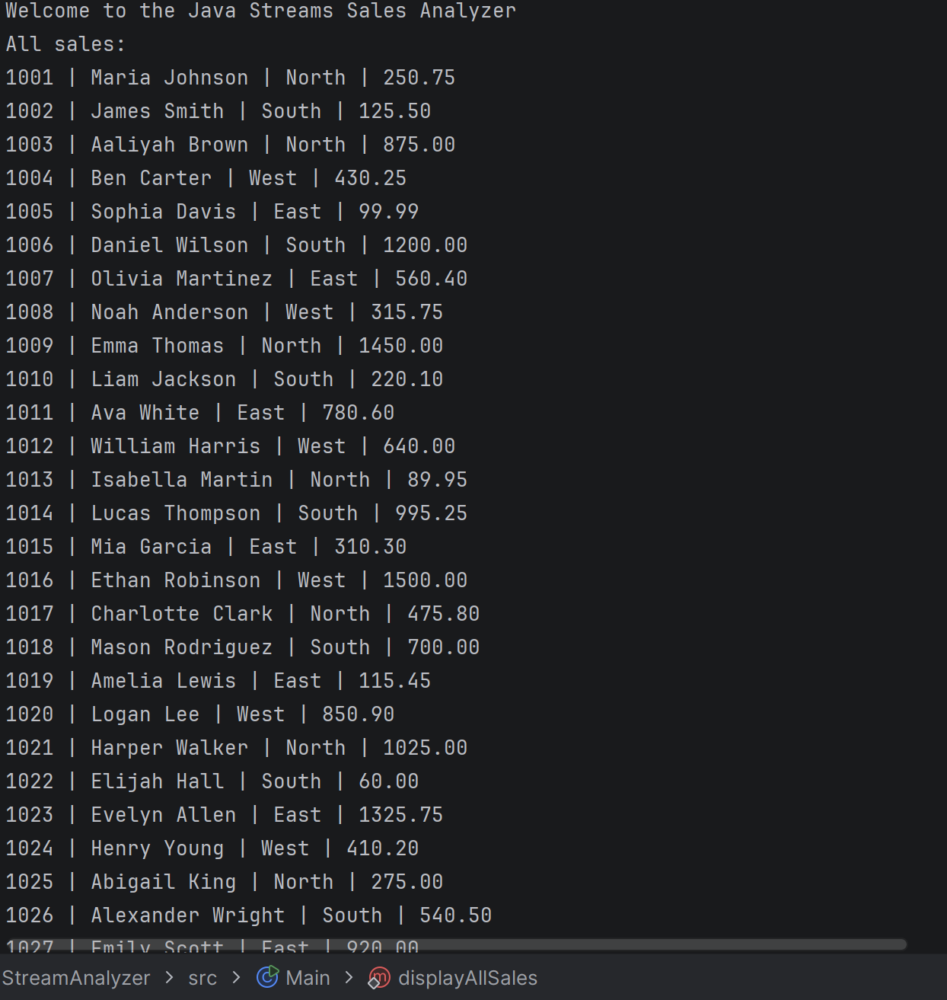

# Sales Data Stream Analyzer

This program allows the user to provide a .csv vile in the root folder that will then be read and organized into data that can be more easily digested.

# How to run

Once the `.jar` file is built, the user can run the program using `java -jar SalesDataStreamAnalyzer.jar`. Make sure the `sales.csv`file is in the same folder!

# Images

